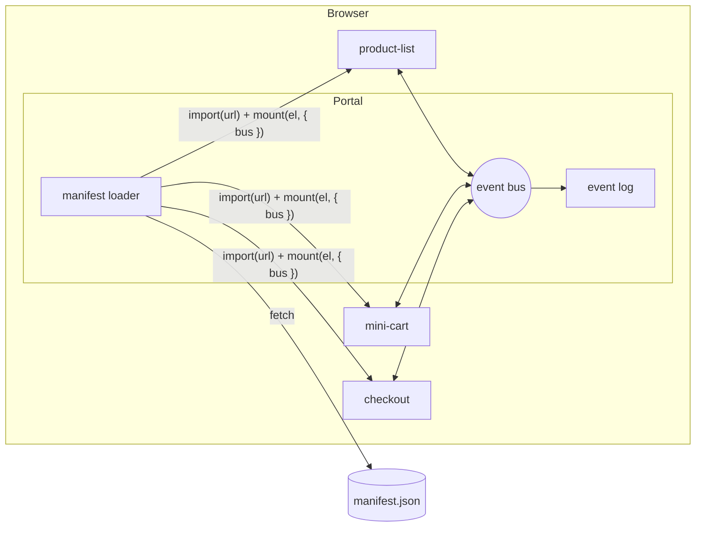

# Shopfront: a micro-frontend reference

A small shop assembled from independently built and independently runnable applications. A **portal** loads three **widgets** at runtime from a manifest. The widgets know nothing about each other and coordinate only through an event bus owned by the portal.

```
Catalog                                   Checkout
┌──────────────────┬───────────┐          ┌──────────────────┬───────────┐
│  product-list    │ mini-cart │   ───▶   │  checkout        │ mini-cart │
└──────────────────┴───────────┘          └──────────────────┴───────────┘
```

Clicking **Go to checkout** in `mini-cart` closes `product-list` with an exit animation and registers `checkout` in its place. `mini-cart` stays mounted the whole time.

Every widget is drawn inside a dashed frame labelled with its name and version, so it is easy to see where one widget ends and another begins. The **Widget outlines** switch in the header turns the frames off.

## Quick start

Requires Node.js 20.19+ or 22.12+.

```bash
npm install
npm run dev
```

Open <http://localhost:5100>.

| Command | What it does |
|---|---|
| `npm run dev` | Starts the portal and all widgets on Vite dev servers, with hot reload. |
| `npm run dev:portal`, `dev:product-list`, `dev:mini-cart`, `dev:checkout` | Starts a single project. |
| `npm run build` | Builds every project. |
| `npm start` | Builds everything and serves the production output: <http://localhost:4100>. |
| `npm run type:check` | Type-checks every project. |

`dev` serves source files on the fly through Vite. `start` serves the built bundles from each project's `dist/` folder, which is what would be deployed.

## Architecture



Rules the code follows:

- Widgets never import each other. The only thing they share with the portal is [`contracts`](contracts/src), and it contains types only.
- The portal knows nothing about a widget's internals. A widget is an ES module with two exports, `mount` and `unmount`.
- Every project builds, runs and deploys on its own. npm workspaces only make `npm install` a single command.
- There is no backend. Every request is a stub that resolves a JSON file from the widget's `src/__mocks__/` folder, marked with the endpoint it stands for.

## Projects

| Path | Role | Dev port | Preview port |
|---|---|---|---|
| [`portal/`](portal) | Layout, manifest loader, event bus, screens, event log | 5100 | 4100 |
| [`widgets/product-list/`](widgets/product-list) | Browse products, add to cart | 5101 | 4101 |
| [`widgets/mini-cart/`](widgets/mini-cart) | Owns the cart, shows it, goes to checkout | 5102 | 4102 |
| [`widgets/checkout/`](widgets/checkout) | Order summary, order form, confirmation | 5103 | 4103 |
| [`contracts/`](contracts) | Event map, `Bus` and `WidgetModule` interfaces, shared models | | |

### Widget layout

Widgets are organised by feature. Each feature owns its API access, hooks, components and styles, and exposes a small public surface through `index.ts`.

```
widgets/mini-cart
├── index.html                  standalone page
├── dev/
│   ├── standalone/             mock bus and controls for running the widget alone
│   └── portal/                 entry the portal loads in dev (hot reload)
└── src/
    ├── index.tsx               widget contract: mount / unmount
    ├── MiniCart.tsx            composition of the features
    ├── features/
    │   ├── cart-state/         cart model, loading, reacting to events
    │   ├── cart-lines/         list of cart lines
    │   ├── cart-summary/       total
    │   └── checkout-link/      button and navigation event
    ├── shared/                 formatting helpers
    └── __mocks__/              JSON responses for the stubbed API
```

`dev/` is never part of the production bundle.

### Portal layout

```
portal/src
├── core/          event bus, manifest, widget loader
├── hooks/         useManifest, useScreen, usePresence, useEventLog
├── components/    Header, WidgetSlot, WidgetHost, EventLog
├── screens.ts     which widgets are active on which screen
└── App.tsx
```

## The widget contract

```ts
export interface WidgetModule {
  mount(element: HTMLElement, context: { bus: Bus }): void;
  unmount(): void;
}
```

A widget renders into the element it is given and talks to the outside world through `bus`. See [`widgets/mini-cart/src/index.tsx`](widgets/mini-cart/src/index.tsx).

## Event bus

```ts
bus.publish('cart.addRequested', { product });

const unsubscribe = bus.subscribe('cart.changed', render, { replay: true });
unsubscribe();
```

Topics and payloads are typed by `EventMap` in [`contracts/src/events.ts`](contracts/src/events.ts), so a wrong topic or payload fails at compile time.

| Event | Published by | Consumed by |
|---|---|---|
| `cart.addRequested` | product-list | mini-cart |
| `cart.changed` | mini-cart | product-list, checkout |
| `navigation.requested` | mini-cart, checkout | portal |
| `order.placed` | checkout | mini-cart |

The cart is owned by `mini-cart`. Other widgets ask for changes with `cart.addRequested` and learn the result from `cart.changed`, which carries a full snapshot. `order.placed` tells the owner to empty the cart. When the cart runs out of items on the checkout screen, `checkout` asks the portal to go back to the catalog.

Delivery is asynchronous and isolated: a throwing subscriber does not affect the others. With `replay: true` a subscriber that mounts late receives the last payload of the topic, which is how `checkout` shows the cart it did not exist for. See [`portal/src/core/eventBus.ts`](portal/src/core/eventBus.ts).

## Manifest and independent deploys

The portal decides what to load from a manifest that is fetched at runtime, not bundled:

```json
{ "name": "mini-cart", "slot": "aside", "version": "1.0.0", "url": "http://localhost:4102/1.0.0/index.js" }
```

Each widget build lands in `dist/<version>/`. Releasing a widget does not touch the portal:

```bash
# 1. bump "version" in widgets/mini-cart/package.json to 1.1.0
npm run build -w @shop/mini-cart              # dist/1.1.0 next to dist/1.0.0
# 2. point mini-cart at 1.1.0 in the manifest served by the portal, then reload
```

Rolling back is putting the previous version back. A widget that fails to load is replaced by an "unavailable" tile and the rest of the portal keeps working.

## Development

**Standalone.** Each widget runs on its own with a mock bus, a panel that shows the events it publishes, and buttons that simulate the events it normally receives:

```bash
npm run dev:mini-cart        # http://localhost:5102
```

**Inside the portal.** `npm run dev` serves the portal a development manifest ([`portal/public/manifest.dev.json`](portal/public/manifest.dev.json)) that points at the widgets' Vite dev servers. Each entry, `dev/portal/entry.ts`, installs the React Refresh runtime and re-exports the widget module, so component edits hot-reload inside the portal without losing page state.

## Trade-offs

- **Every widget bundles its own React** (about 85 KB gzipped each). It keeps widgets fully independent and makes hot reload trivial. Sharing React through an import map or Module Federation removes the duplication at the cost of a shared version constraint.
- **Style isolation comes from CSS Modules** with a per-project class prefix. Global styles from the portal do not reach into widgets; only the design tokens (`--shop-*` custom properties, with fallbacks) do. Shadow DOM would give hard isolation at the cost of more plumbing.
- **State travels in events.** With no backend to read from, the cart owner publishes snapshots and the bus replays the last one to late subscribers. With a real backend, events could shrink to signals and each widget would read its own data.
- **The bus is in-memory and per-tab.** Events do not survive a reload and do not cross tabs.

## Adding a widget

1. Copy a folder from `widgets/` and change the package name, ports and CSS class prefix in `vite.config.ts`.
2. Implement the widget as features and export `mount` / `unmount` from `src/index.tsx`.
3. Add new events to [`contracts/src/events.ts`](contracts/src/events.ts).
4. Add an entry to both manifests in `portal/public/`, and to a screen in [`portal/src/screens.ts`](portal/src/screens.ts).
5. Add `dev:<name>` to the root `package.json` and the widget to the `dev` and `start` commands.
